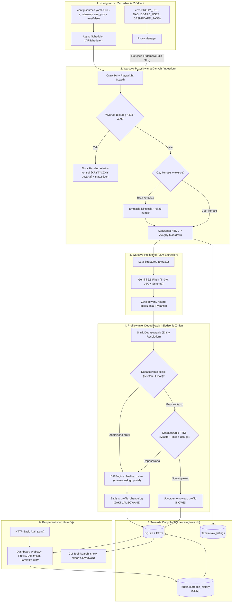

# System Pozyskiwania i Profilowania Ogłoszeń Opiekunów
## Dokument 02: Architektura Systemu (Architecture Document)

**Wersja:** 4.0 (Autentykacja i Konfiguracja Proxy)  
**Status:** Zatwierdzony  
**Data:** 2026-11-22  

---

### 1. Przegląd Architektury
System został zaprojektowany zgodnie z zasadą **maksymalnej prostoty implementacyjnej i operacyjnej** (Zero-Overhead Architecture). Oparty jest w 100% na standardowym Pythonie 3.11+, plikowej bazie SQLite z wbudowanym modułem pełnotekstowym **FTS5**, deklaratywnej konfiguracji YAML, obsłudze rotującego proxy domowego (residential) dla zabezpieczonych portali (jak OLX) oraz prostym uwierzytelnianiu dostępu do panelu WWW (HTTP Basic Auth). W całym systemie obowiązuje profesjonalny styl wizualny i komunikacyjny **bez użycia emoji**.



---

### 2. Dobór Komponentów Technologicznych i Uzasadnienie

| Komponent | Wybrana Technologia | Uzasadnienie |
| :--- | :--- | :--- |
| **Język bazowy** | Python 3.11+ | Standard branżowy w scrapingu i LLM, asynchroniczność (`asyncio`). |
| **Konfiguracja źródeł** | **PyYAML (`config/sources.yaml`)** | Deklaratywne definiowanie portali, startowych URL-i, kategorii i flagi `use_proxy`. |
| **Obsługa Proxy** | **Rotujące Proxy Domowe (Residential)** | Pojedynczy endpoint (np. Webshare, Smartproxy, IPRoyal). Wymagany dla OLX ze względu na systemy DataDome. |
| **Baza danych** | **Natywny SQLite + FTS5** | Plikowa baza danych (`caregivers.db`). Zero instalacji serwerów, wbudowany moduł FTS5 z tokenizatorem `unicode61 remove_diacritics 2`. |
| **Silnik scrapingu** | **Crawl4AI / Playwright Stealth** | Automatyczna konwersja HTML do Markdown, obsługa dynamicznych stron SPA, obsługa proxy i klikanie przycisków. |
| **Model LLM** | **Gemini 2.5 Flash / Gemini 3 Flash** | Niskie koszty, wysoka szybkość, natywne **Structured Outputs (Pydantic)**. Brak zbędnych wektorów embeddings. |
| **Autentykacja** | **HTTP Basic Auth** | Proste i bezpieczne zabezpieczenie Dashboardu hasłem ze zmiennych środowiskowych `.env`. |
| **Scheduler** | **APScheduler (AsyncIOScheduler)** | Elastyczne harmonogramowanie zadań w tle. |
| **Interfejs użytkownika** | **FastAPI + Szablon HTML/Tailwind** | Jednokomendowy dashboard (`python -m caregiver_agent ui`), czysty styl bez emoji, formularz CRM. |

---

### 3. Strategia Anty-Scrapingowa i Proxy dla OLX

1. **Dlaczego Residential Proxy dla OLX?**
   - OLX korzysta z zaawansowanych zabezpieczeń (DataDome). Tradycyjne adresy IP z centrów danych (datacenter) są szybko blokowane (HTTP 403).
   - Rozwiązaniem jest pojedynczy endpoint rotującego proxy domowego (Residential IP). Każde zapytanie otrzymuje nowy, wiarygodny polski adres IP (np. Orange, Play).
2. **Oszczędność transferu proxy:**
   - Flaga `use_proxy: true` w `sources.yaml` aktywuje proxy tylko dla wymagających portali (jak OLX).
   - Mniej restrykcyjne portale (np. Oferteo) działają na zapytaniach bezpośrednich (`use_proxy: false`), oszczędzając transfer proxy.

---

### 4. Monitorowanie i Informowanie o Blokadach (Bez Emoji)

- **Konsola (Baner ANSI):**
  ```text
  ================================================================================
  [KRYTYCZNY ALERT: BLOKADA SESJI / ANTY-BOT]
  Portal:         OLX (https://www.olx.pl/uslugi/...)
  Typ zdarzenia:  Cloudflare / DataDome Challenge / HTTP 403 Forbidden
  Czas zdarzenia: 2026-11-22 12:24:15
  Działanie:      Wstrzymano zadania dla tego portalu na 60 minut (cooldown).
                  Pozostałe portale kontynuują pracę.
  Status:         Zaktualizowano plik status.json.
  ================================================================================
  ```
- **Plik Stanu (`status.json`):**
  Utrzymywany w czasie rzeczywistym, zawiera kody błędów i czasy wznowienia zadań.
